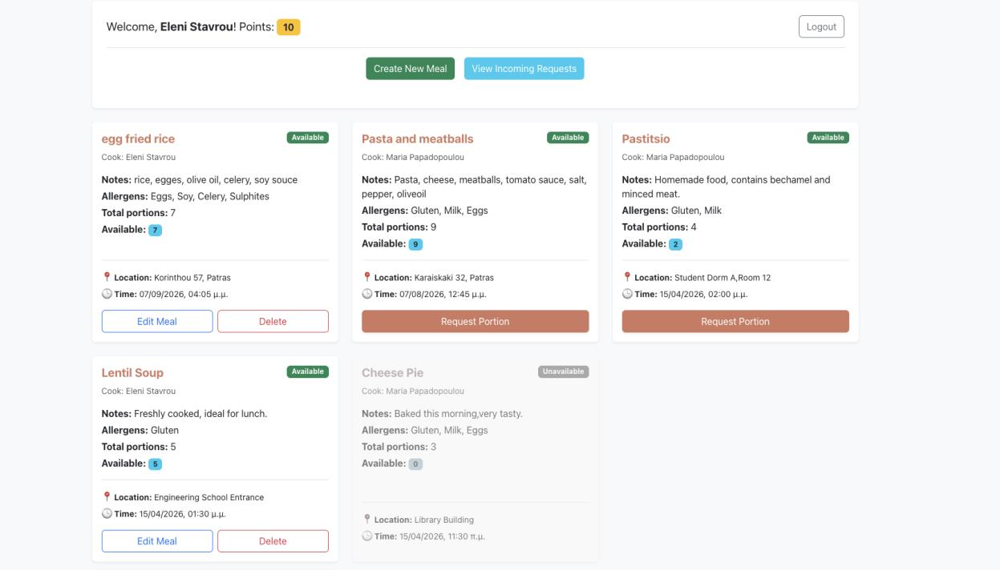
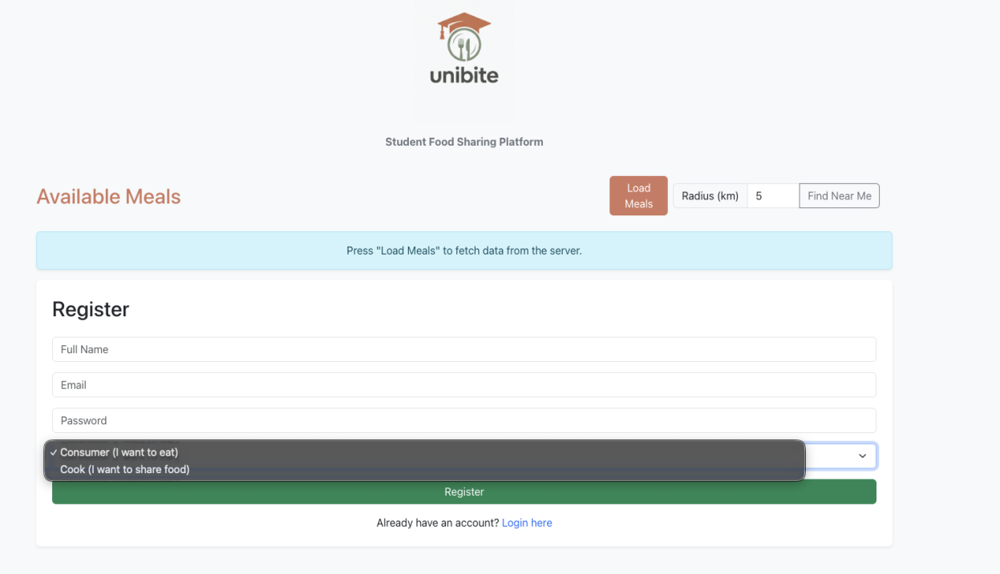
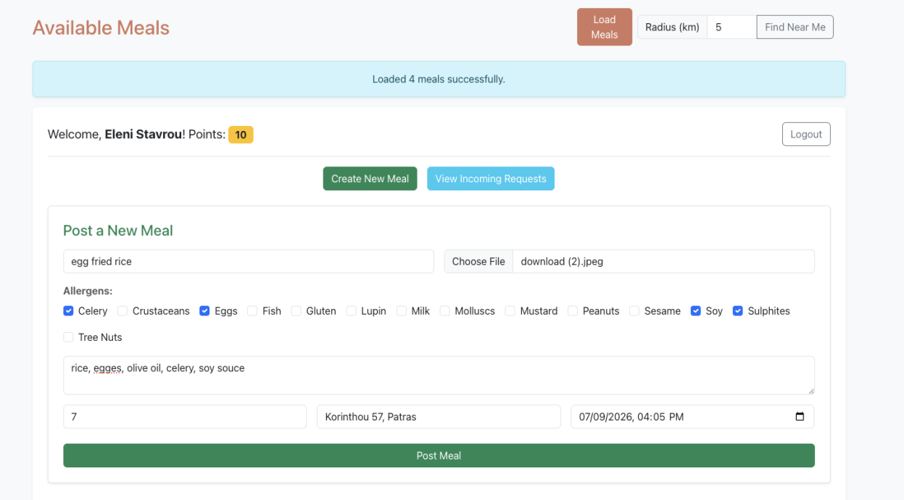
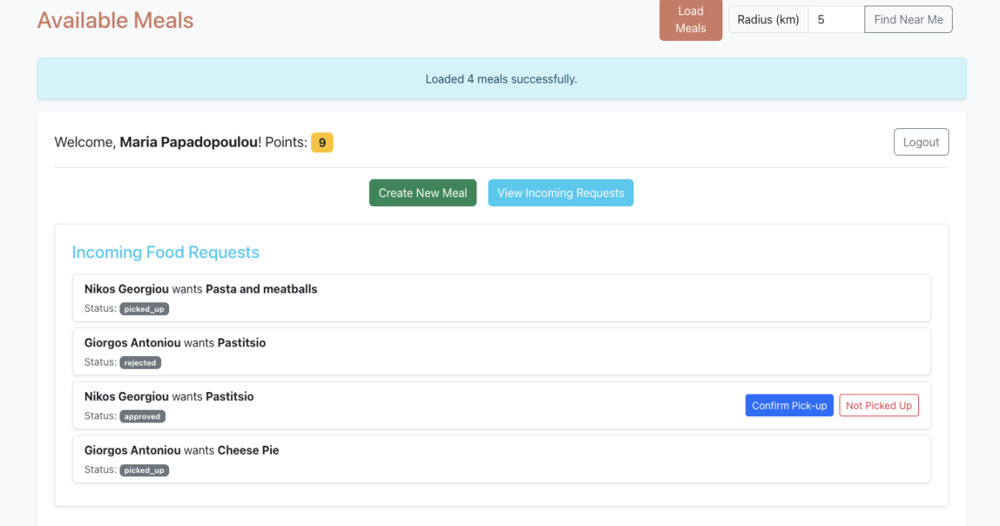
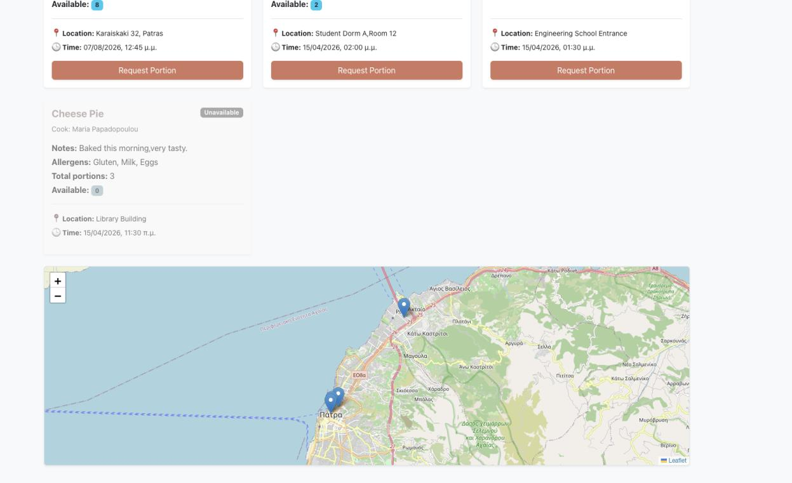
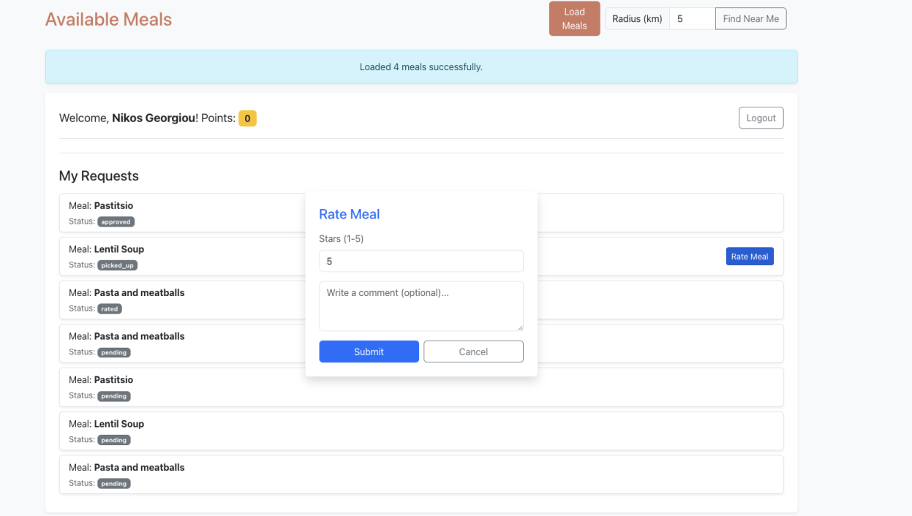
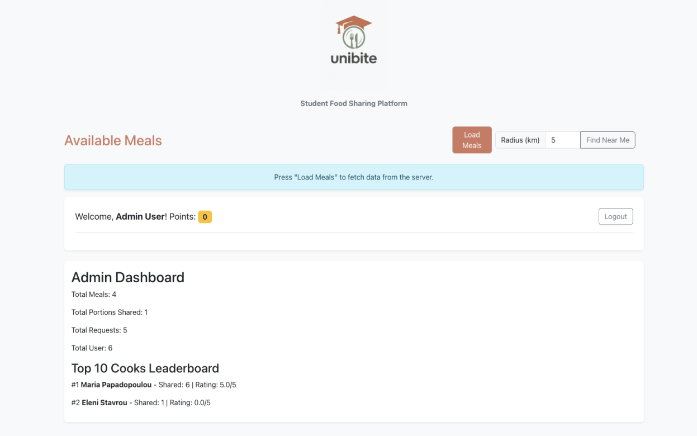
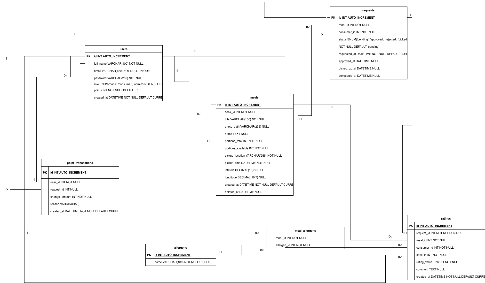

# UniBite — Student Food Sharing Platform

UniBite is a full-stack web app that lets university students share home-cooked meals. **Cooks** post meals with portions, allergens, a pickup place and time; **consumers** browse them on a list or a map, request a portion, and rate the meal after pickup. A **points economy** keeps the exchange fair: requesting a meal costs a point, while cooking and getting good ratings earns points.

Built for the *Web Programming* course at the Department of Computer Engineering & Informatics (CEID), University of Patras.



## Features

- **Accounts and roles:** registration and login with three roles (cook, consumer, admin), bcrypt-hashed passwords and JWT authentication
- **Meal management:** cooks create, edit and delete meals with a photo upload, notes, portions, pickup time and location, and the 14 EU allergens
- **Map and "Find near me":** pickup addresses are geocoded with OpenStreetMap Nominatim and shown on a Leaflet map; consumers can filter meals by distance from their location
- **Request workflow:** `pending → approved / rejected → picked_up / not_picked_up → rated`, with portions reserved on approval and returned on a no-show
- **Points system:** new users start with 5 points; a request costs 1 (refunded if rejected), a confirmed pickup earns the cook 1, a rating above 3 stars earns the cook 1 more, and a no-show costs the consumer the point. Every change is logged in `point_transactions`, and multi-step updates run inside **MySQL transactions** so balances stay consistent
- **Ratings:** consumers rate picked-up meals from 1 to 5 with an optional comment
- **Admin dashboard:** platform statistics and a top-10 cooks leaderboard

## Tech stack

| Layer | Technologies |
|---|---|
| Frontend | HTML, vanilla JavaScript, Bootstrap 5, Leaflet + OpenStreetMap |
| Backend | Node.js, Express, Multer (image uploads), JSON Web Tokens, bcryptjs |
| Database | MySQL (via `mysql2` connection pool) |

## Screenshots

| Register | Create a meal |
|---|---|
|  |  |
| **Cook: incoming requests** | **Find near me (map)** |
|  |  |
| **Rating a meal** | **Admin dashboard** |
|  |  |

## Database

Seven tables: `users`, `meals`, `allergens`, `meal_allergens`, `requests`, `ratings`, `point_transactions`.



## Getting started

### Prerequisites
- [Node.js](https://nodejs.org/) 18+
- [MySQL](https://dev.mysql.com/downloads/) 8+

### 1. Create the database
```bash
mysql -u root -p < backend/create.sql   # creates the `unibite` database and tables
mysql -u root -p unibite < backend/insert.sql   # optional: sample users, allergens and meals
```

### 2. Configure and start the backend
```bash
cd backend
cp .env.example .env    # then fill in your MySQL password and a JWT secret
npm install
npm start               # API runs on http://localhost:3000
```

### 3. Open the frontend
Serve the `frontend/` folder with any static server, for example the VS Code **Live Server** extension or:
```bash
cd frontend
npx serve -l 5500
```
Then open http://localhost:5500. The admin dashboard is at `/admin.html`.

### Sample accounts (from `insert.sql`)
| Role | Email | Password |
|---|---|---|
| Cook | maria@unibite.gr | 123456 |
| Consumer | nikos@unibite.gr | 123456 |
| Admin | admin@unibite.gr | admin123 |

The sample passwords are stored in plain text and are converted to bcrypt hashes automatically on first login.

## API overview

| Method | Endpoint | Description |
|---|---|---|
| POST | `/api/auth/register` | Create an account |
| POST | `/api/auth/login` | Log in and receive a JWT |
| GET | `/api/meals?lat=&lng=&radius=` | List meals, optionally within a radius (km) |
| POST / PUT / DELETE | `/api/meals/:id` | Create (with image), edit, delete a meal (cook) |
| GET | `/api/allergens` | List allergens |
| POST | `/api/requests` | Request a portion (consumer, costs 1 point) |
| GET | `/api/requests/me` · `/api/requests/cook` | My requests / requests for my meals |
| PATCH | `/api/requests/:id/status` | Approve, reject, confirm pickup or mark no-show |
| POST | `/api/ratings` | Rate a picked-up meal |
| GET | `/api/points/history` | Points transaction history |
| GET | `/api/admin/stats` · `/api/admin/leaderboard` | Admin statistics and leaderboard |

## Project structure
```
├── backend/
│   ├── index.js            # Express app and API routes
│   ├── routes/auth.js      # Register / login
│   ├── middleware/auth.js  # JWT verification
│   ├── db.js               # MySQL connection pool
│   ├── create.sql          # Schema
│   └── insert.sql          # Sample data
├── frontend/               # index.html, app.js, admin.html, admin.js, style.css
├── database/               # Full database export
└── docs/                   # ER diagram, screenshots, project report (Greek)
```

## Team and my contribution

Developed as a two-person team project by **Dimitrios Tsalachouris** and **Vasileios Zachariadis**.

My contribution: _TODO_

## Report

The full project report (in Greek) is in [`docs/project-report.pdf`](docs/project-report.pdf).
